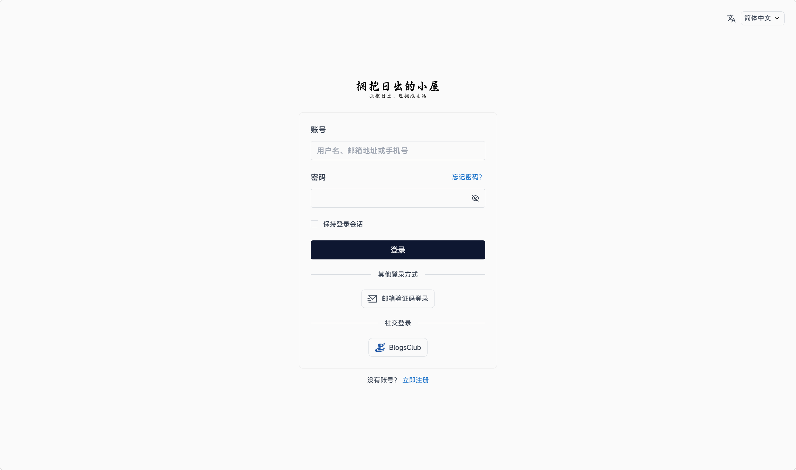
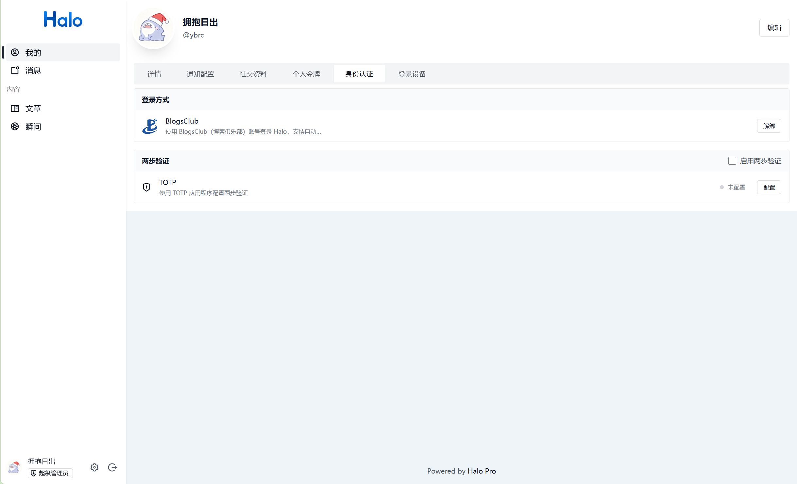

# BlogsClub 账号验证

[](LICENSE)

让 Halo 站点支持使用 **BlogsClub（博客俱乐部）** 开放平台账号登录与绑定。


## 截图

**登录页新增 BlogsClub 入口**



**个人中心可绑定 / 解绑 BlogsClub 账号**



## 功能

- 登录页新增「使用 BlogsClub 登录」入口，基于 Halo 官方 `AuthProvider` / OAuth2 扩展点实现
- **首次登录自动建号**： BlogsClub 授权通过后按站点的注册策略创建 Halo 账号；若站点允许注册，插件会把 BlogsClub 回调返回的邮箱、昵称、头像一并写入，其中邮箱因来自**刚刚完成认证**的身份提供方，Halo 视其为已提供，用户无需再做邮箱验证
- 已绑定用户直接登录；个人中心可随时绑定 / 解绑 BlogsClub 账号
- AppID / AppKey 未配置时显示中文提示页，而不是抛出空白 500 错误
- 支持弹窗（popup）模式：`/oauth2/authorization/blogsclub?display=popup`

## 隐私与数据说明

本插件仅在你主动点击「使用 BlogsClub 登录」时，才会将浏览器跳转到 BlogsClub 开放平台完成授权。

- 插件向 BlogsClub 请求的scope：`basic,email`
- 从 BlogsClub 读取并保存到 Halo 用户资料的字段：`openid`（身份唯一标识）、`email`、`blog_name`（昵称）、`blogger_avatar`（头像）、`blog_url`
- **AppID / AppKey** 保存在 Halo 的认证方式配置中（AppKey 使用密码框，界面上不明文展示），仅用于服务端换取 `access_token`
- 插件**不会**将用户数据发送到除 `www.blogsclub.org` 以外的任何地址；不收集统计、不上报行为数据
- 卸载插件或解绑账号不会自动删除已创建的 Halo 用户

如果你不同意上述数据处理方式，请不要使用本插件。

## 兼容性

| 项目 | 要求 |
|------|------|
| Halo 版本 | `>=2.20.8` |
| Java | 21+ |
| BlogsClub | 需在开放平台创建并通过审核的应用 |

> `>=2.20.8` 是因为插件使用 Halo 2.20.8 引入的 `UserPreCreatingHandler` 扩展点在建号前写入用户资料。

## 安装

### 从应用市场安装（推荐）

在 Halo 后台「插件」→ 应用市场，搜索 **BlogsClub 账号验证** 并安装。

### 手动安装 JAR

1. Halo 后台「插件」→「上传插件」，选择 `plugin-blogsclub-1.1.0.jar`；
2. 安装完成后**启用**插件；
3. 进入「用户」→「认证方式」，找到 **BlogsClub** 并**启用**；
4. 点击该条目的**「设置」**，填写 **AppID** 与 **AppKey**（见下方）。

## 配置

### 1. 在 BlogsClub 开放平台创建应用

在 [BlogsClub 开放平台](https://www.blogsclub.org/platform.html) 创建应用并通过审核，获得 **AppID** 与 **AppKey**，并登记授权回调地址（必须与你的 Halo 外网地址完全一致）：

```
https://你的站点域名/login/oauth2/code/blogsclub
```

> `{baseUrl}` 取自 Halo 的 `halo.external-url` 配置，即你访问后台所用的地址。

### 2. 在 Halo 后台填写凭据

进入 **用户 → 认证方式 → BlogsClub → 设置**，填写：

| 字段 | 说明 |
|------|------|
| **AppID（Client ID）** | BlogsClub 开放平台应用详情页获取 |
| **AppKey（Client Secret）** | 同一应用对应的 AppKey，**以密文显示**，仅用于服务端换取令牌 |

两项均为必填。缺失时插件会 fail-closed（绝不以空凭据向 BlogsClub 发起请求），并提示你前往该配置页填写。

## 首次登录流程

1. 博主点击「使用 BlogsClub 登录」，跳转授权页并同意授权；
2. Halo 回调插件，插件用 AppID / AppKey 换取 `access_token`，并拉取博主资料；
3. 若该 `openid` **已绑定**本站账号 → 直接登录，跳转个人中心；
4. 若**未绑定** → Halo 自动创建账号，插件在建号前（`UserPreCreatingHandler`）把 BlogsClub 回调返回的 **邮箱 / 昵称 / 头像**写入新账号 —— 因为邮箱来自刚刚完成认证的身份提供方，Halo 视其为已提供，用户**不需要再做邮箱验证**；
5. 完成后自动登录并跳转个人中心。

之后博主既可一键 BlogsClub 登录，也可使用 Halo 的「忘记密码」功能自行设置站点密码。

## 排障

| 现象 | 原因与处理 |
|------|-----------|
| 点击登录提示「尚未完成 BlogsClub 配置」 | AppID / AppKey 未填写，去 **用户 → 认证方式 → BlogsClub → 设置** 填写 |
| BlogsClub 侧提示回调地址不匹配 | 登记的回调地址必须与 `halo.external-url` 完全一致，含协议与末尾无斜杠 |
| 日志出现 `ConfigMap/oauth2-blogsclub-config was not found` | 认证方式未启用或配置未保存，重新启用并保存一次 |
| 新账号邮箱为空 | 检查日志中 `[BlogsClub] 已缓存 BlogsClub 资料` 与 `[BlogsClub] 已自动写入 BlogsClub 邮箱` 两行是否出现 |
| BlogsClub 未开通 `email` 权限 | 授权页确认勾选了邮箱权限，否则新账号邮箱会为空 |

日志中的 `requestId` 可用于在 Halo 日志里定位同一次请求的完整堆栈。

## 可选：通过代理访问 BlogsClub

当 Halo 服务器无法直连 `www.blogsclub.org` 时，在 `application.yaml` 中配置：

```yaml
blogsclub:
  oauth2:
    proxy:
      enabled: true
      host: proxy.example.com
      port: 3128
      username: ""        # 可选
      password: ""        # 可选，建议用环境变量注入，勿提交到版本库
      connect-timeout-millis: 15000
```

出于安全考虑，`host` 仅接受纯主机名 / IP（不含协议、端口、路径）。

## 更新日志

### v1.1.0

面向应用市场审核意见的兼容性修复，共 4 项：

- **使用独立资源类型，不再与官方 OAuth2 认证插件冲突**

  v1.0.x 之前，插件注册了与官方 OAuth2 认证插件**完全相同**的资源类型（`oauth.halo.run/v1alpha1` 的 `AuthorizedClient` 与 `Oauth2ClientRegistration`），并在停用时无条件注销。两个插件共存时，停用其中一个会连带注销另一个仍在使用的资源类型，导致其他 OAuth 登录方式的配置读取与令牌保存失效。

  现已将两者改为插件私有分组 `blogsclub.oauth.ybrc114514.io/v1alpha1`：

  | 用途 | 旧资源类型 | 新资源类型 |
  |------|-----------|-----------|
  | 已授权客户端 | `oauth.halo.run/v1alpha1` `AuthorizedClient` | `blogsclub.oauth.ybrc114514.io/v1alpha1` `BlogsClubAuthorizedClient` |
  | 客户端注册 | `oauth.halo.run/v1alpha1` `Oauth2ClientRegistration` | `blogsclub.oauth.ybrc114514.io/v1alpha1` `BlogsClubClientRegistration` |

  插件启停只注册 / 注销自己的两个私有类型，不可能波及官方插件。**升级后无需任何配置变更**，AppID / AppKey 原样保留。

- **修复首次登录的资料回填失效**

  之前的资料缓存逻辑判断了错误的认证结果类型：Halo 会把 OAuth2 认证结果包装为 `HaloOAuth2AuthenticationToken`，而代码只判断了原始的 `OAuth2AuthenticationToken`，导致「已验证但尚未绑定」的会话进不了缓存，邮箱、昵称、头像的回填分支**从不执行** —— 新账号邮箱为空。现已兼容两种令牌形态。

- **资料回填严格绑定当前会话，不再推测用户身份**

  资料缓存现在同时记录**已验证的 BlogsClub 身份（openid）**与**当前 Web 会话 id**，建号时只允许领取同一会话的资料。已移除「按昵称匹配」和「缓存中仅有一条就认为是你」的推测逻辑 —— 这两种做法在多用户同时登录、或同一用户开多个标签页时会写入错误用户的资料。若会话无法唯一匹配，插件宁可跳过回填，也不会写错人。

- **修正插件命名空间与应用 ID 声明**

  业务类的 Java 包名由 `run.halo.plugin.blogsclub` 迁移为 `io.github.ybrc114514.blogsclub`（避免与 Halo 官方代码归属混淆），扩展点注册中的类名引用已同步更新；`plugin.yaml` 中的 `store.halo.run/app-id` 由错误的 `app-blogsclub` 修正为实际应用 ID `app-yjha8jz5`。

本次为纯兼容性修复，不涉及配置项变更与数据库迁移。

### v1.0.1

- **修复全站 404 / 500 错误页面被劫持的问题**

  从 v1.0.0 起，站点上任何访问不到的地址（例如不存在的文章 `/1111`）都会被替换成「BlogsClub 登录失败」页面，站点自身的错误页无法正常显示。原因是插件的登录过滤器误将非登录请求的异常也一并拦截。

  现已将拦截范围收窄至 BlogsClub 自身的登录接口，其余请求交由 Halo 与主题正常处理，404、500 页面恢复原样。

  本次为紧急修复版本，不涉及配置变更，无需重新填写 AppID / AppKey。

### v1.0.0

- 首个正式版本：BlogsClub 账号 OAuth 2.0 登录、首次登录自动注册、邮箱自动填充并完成验证、账号绑定与解绑

## 安全说明

- 所有对 BlogsClub 的请求经响应式 `WebClient` 发出，连接与响应超时均为 15s，响应体上限 256KB
- 目标地址固定为 `www.blogsclub.org`，不接受用户可控的目标覆写，以降低 SSRF 风险
- 回调失败或 AppKey 缺失时 **fail-closed**，不会以空密钥继续请求
- 凭据缺失时插件拒绝继续流程（fail-closed），不会静默降级

## 构建

```bash
./gradlew clean build
# 产物：build/libs/plugin-blogsclub-1.1.0.jar
```

运行单元测试：

```bash
./gradlew test
```

## 目录结构

```
src/main/java/io/github/ybrc114514/blogsclub/
  BlogsClubPlugin.java                        插件主类（注册 / 注销插件私有资源类型）
  BlogsClubAuthenticationWebFilter.java       OAuth2 回调过滤器（含出站 WebClient 配置）
  BlogsClubRedirectWebFilter.java             授权跳转过滤器（透传 popup display 参数）
  BlogsClubRequests.java                      BlogsClub 接口路径判定（防止过滤器劫持全站错误页）
  BlogsClubSessionContext.java                当前 Web 会话上下文（把资料绑定到已验证的会话）
  BlogsClubOAuth2UserService.java             userinfo 适配器（解包 data / 映射 openid）
  BlogsClubClientRegistrationRepository.java  客户端注册仓库（读取 AppID / AppKey）
  BlogsClubUserPreCreatingHandler.java        建号前写入 BlogsClub 邮箱 / 昵称 / 头像
  BlogsClubClientRegistration.java            Scheme 定义（私有分组）
  BlogsClubAuthorizedClient.java              授权客户端 Scheme 定义（私有分组）
  DefaultOAuth2AuthorizedClientService.java   授权客户端持久化
  UserConnectionDisconnectedListener.java     解绑时清理授权客户端
src/main/resources/extensions/
  auth-provider.yaml                          认证方式定义
  client-registrations.yaml                   BlogsClub 端点与 scheme
  extension-definitions.yaml                  扩展点注册
  setting.yaml                                AppID / AppKey 配置表单
```

## 致谢

- [BlogsClub 开放平台](https://www.blogsclub.org/platform.html) —— 提供 OAuth 2.0 接口

## 许可证

[GPL-3.0](LICENSE)

## 反馈

问题反馈与功能建议请提交到 [GitHub Issues](https://github.com/YBRC114514/plugin-BlogsClub-OAuth/issues)。